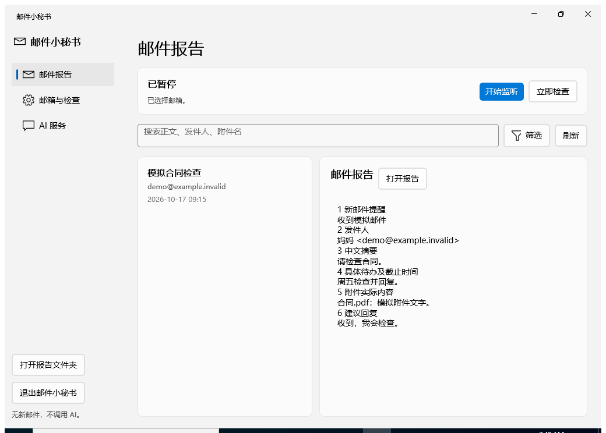
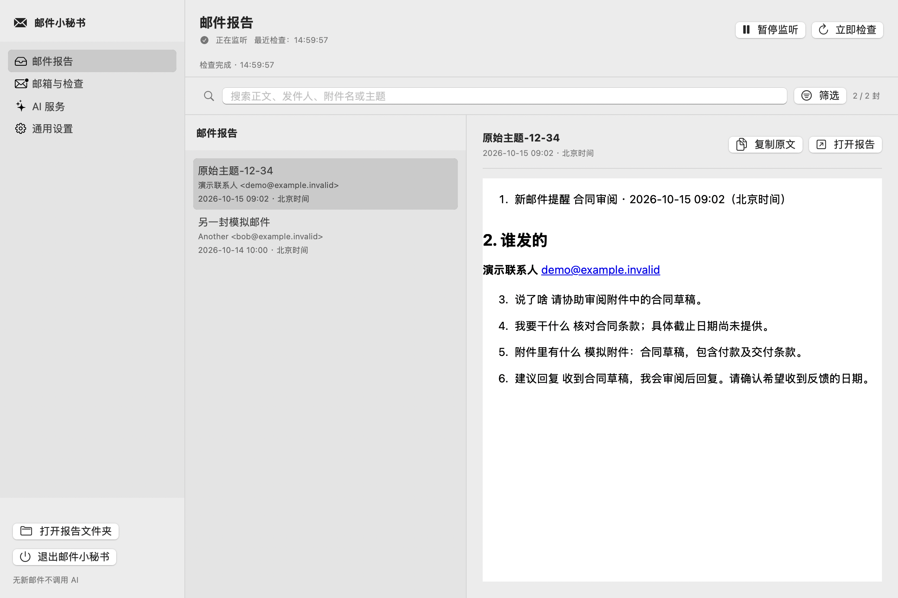

# 邮件小秘书 · Email Assistant

[English](README.en.md) · [Español](README.es.md) · [下载安装包](https://github.com/Benson-YiYan/benson-mail-assistant/releases/latest)

新邮件来了，自动整理成六项：**新邮件提醒、谁发的、说了啥、我要做什么、附件内容、怎么回复**。

支持 Windows 和 Mac，提供原生界面、多个邮箱和自选 AI。**没有新邮件或待重试任务时，不调用 AI；建议回复由你决定是否发送。**

## 下载

普通用户直接下载安装包，无需下载源码或运行命令行。

| 电脑 | 选择的安装包 | 系统要求 |
| --- | --- | --- |
| Windows x64 | `BensonMail-Windows-x64-Setup-….exe` | Windows 10 / 11 |
| Mac，Apple 芯片（M 系列） | `BensonMail-Mac-AppleSilicon-….dmg` | macOS 14+ |
| Mac，Intel 处理器 | `BensonMail-Mac-Intel-….dmg` | macOS 14+ |

**[前往最新 Release →](https://github.com/Benson-YiYan/benson-mail-assistant/releases/latest)**

每个安装包的文件名含版本号；同一 Release 中 Windows 和 Mac 的版本号可能不同。`SHA256SUMS.txt` 可用于核对文件完整性。

- Windows：双击 EXE，选择安装位置和快捷方式。已有版本可覆盖安装。
- Mac：打开对应 DMG，将应用拖入“应用程序”后打开。“关于本机”可查看芯片类型。
- Windows 安装器会检测 .NET 8 和 Windows App Runtime 1.8（WinUI 3）；缺少时先征求确认，再下载并安装缺少的组件，已有兼容组件直接复用。Mac 自带所需运行环境；两版均无需安装 Python 或 Homebrew。
- 当前安装包没有发布者代码签名；Mac 未经 Apple 公证。首次打开遇到系统提示时，请核对下载来源，按系统提供的允许方式操作。

## 三步开始

1. **配置邮箱。**选择常见预设，或“其他邮箱（自定义 IMAP）”；启用邮箱的 IMAP 服务，填写账号及服务商要求的授权码、应用密码或 OAuth2 令牌。软件内有“如何获取授权码？”教程。
2. **选择 AI。**填写兼容 Chat Completions 的 API 基础地址、API Key、模型名，或使用本机已安装配置好的 Codex / DeepSeek Harness。软件不捆绑 Harness，也不内置免费 AI 服务；API 模式无需安装 Codex。
3. **选择报告目录，开始监听。**默认每 60 秒检查，可自定义；没有新邮件时只检查邮箱，不调用 AI。

**新添加邮箱的第一次检查只记录收信起点，不会批量分析所有旧邮件。**之后停止、关机期间收到的邮件，在恢复监听时补查，前提是邮件仍在所选文件夹中。

## 功能

- 多邮箱：常见服务商预设，也支持自定义 IMAP 服务器、端口和加密方式。
- 六项 AI 报告：新报告保存为 `.md`，兼容查看旧 `.txt`。
- 本地搜索与筛选：正文、发件人、附件名；日期、发件人、有无附件。
- 简体中文 / English / Español：首次跟随系统语言，也能在设置中切换；新报告使用所选语言，旧报告保持原样。
- 托盘 / 菜单栏运行、自定义检查间隔、自定义保存位置。
- 应用内检查和下载安装更新；有多个下载来源时先做小流量测速，优先较快线路，网络失败时尝试另一条，安装前核对 SHA256。卸载时可选择保留配置和报告。

附件分析依赖可提取的文字，不保证识别扫描图片或加密文件。搜索针对本机已保存的邮件数据和报告，不会搜索整个远端收件箱。

## 界面预览

以下为合成邮件测试界面，没有真实用户邮件。

### Windows

### Mac

## 数据与限制

- 来信正文及可读取的附件文字会发送给**你配置的 AI 服务**；使用前请确认该服务适合处理这些内容。
- 邮箱和 AI 凭据使用系统保护机制保存；请勿在 Issue 中粘贴密码、授权码、令牌或私人邮件。
- 软件不会自动发送回复。测试 AI 连接可能消耗少量服务商额度。
- OAuth2 访问令牌目前需要手动填写和更新，不会自动续期。
- Windows 安装及更新流程在 GitHub Windows runner 验证；Intel Mac 在 Rosetta 下验证，没有物理 Intel Mac 测试。

## 详细说明与开发

| 平台 | 使用说明 | 开发说明 |
| --- | --- | --- |
| Windows | [中文](windows/README.md) / [English](windows/README.en.md) / [Español](windows/README.es.md) | [构建与测试](windows/docs/DEVELOPMENT.md) |
| Mac | [中文](macos/README.md) / [English](macos/README.en.md) / [Español](macos/README.es.md) | [构建与测试](macos/docs/DEVELOPMENT.md) |

源码位于 `windows/` 和 `macos/`。公开仓库中的构建适配与下载的已验证安装包可能具有不同提交；每个 Release 会说明安装包版本及验证范围。

遇到问题可以[提交 Issue](https://github.com/Benson-YiYan/benson-mail-assistant/issues)，附上系统版本、软件版本和脱敏错误信息。

如果这个小秘书帮你省了时间，欢迎点个 ⭐。

## 语言与语言包

界面、安装程序和卸载程序支持**简体中文、英文、西班牙文**。首次使用：中文系统选择中文，西班牙语系统选择西班牙文，其他系统使用英文；之后可在通用设置切换。Windows 安装程序提供“下载简体中文”“下载英文”“下载西班牙文”。

切换到尚未安装的语言时，会提示“你没有下载这个语言，是否现在下载？”。确认后下载；取消或下载失败保留当前语言。新报告跟随所选语言，六项分析要求不变；已有报告不会自动翻译。英文名称为 **Email Assistant**，西班牙文名称为 **Asistente de correo electrónico**。

## 邮箱代理

每个邮箱可分别选择直连、系统代理、HTTP CONNECT 或 SOCKS5。在邮箱设置中打开高级连接与代理选项；启动 v2rayN 等代理软件，填写其实际监听地址、端口和协议，保存后测试连接。代理失败不会悄悄改成直连。这只影响 IMAP 测试与收信，不改变 AI API 网络；不支持 PAC 脚本或需要用户名密码的代理。

## 更新分发

稳定更新清单：[`distribution/manifest.json`](distribution/manifest.json)。源码、文档、语言包和安装程序统一维护在 [Benson-YiYan/benson-mail-assistant](https://github.com/Benson-YiYan/benson-mail-assistant)。不同平台安装包仍是同一 Release 中的独立附件。
